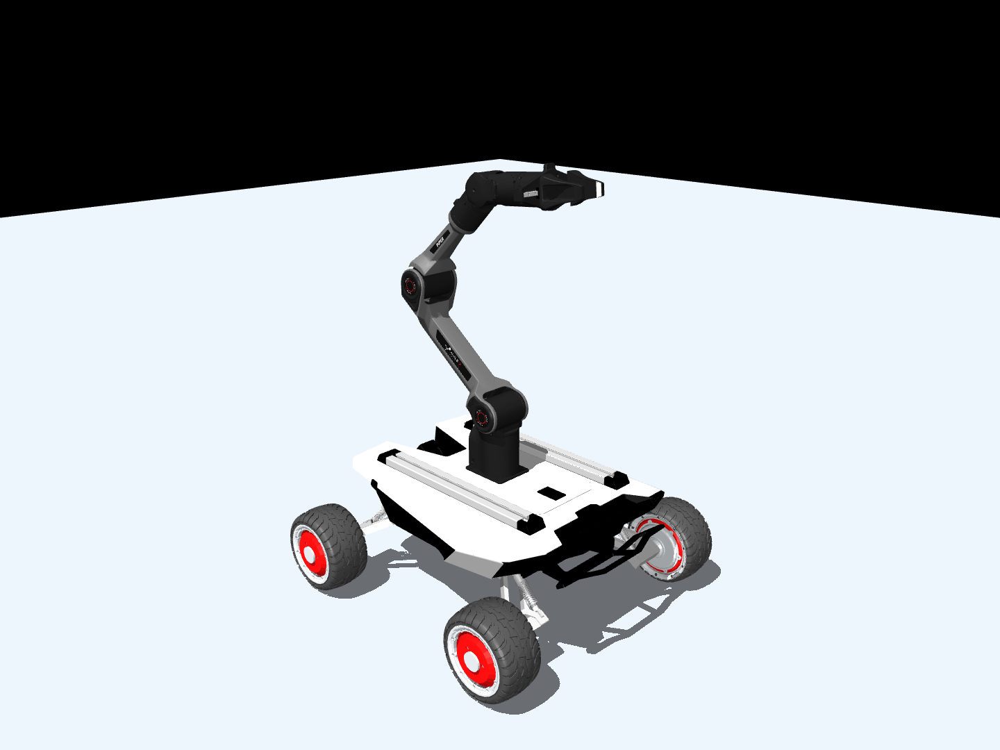

# Scout Mini + standard Piper in MuJoCo

Standalone mobile manipulator for the Robot Dynamics course: four-wheel Scout
Mini, standard Piper 6-DOF arm, and Piper gripper, directly mounted without a
sensor tower. The base is free-moving. Runtime requires MuJoCo and NumPy, with
no ROS, Gazebo or Xacro.



## Install and inspect

```bash
python3 -m venv .venv
source .venv/bin/activate
python -m pip install -r requirements.txt
python scripts/viewer.py --joints
```

Validated with Python 3.12 / MuJoCo 3.17.0. The GUI starts paused: **Space**
runs/pauses, **R** resets home, and the mouse rotates/pans/zooms. The right
**Joint** panel exposes positions; when editing the paused gripper, use
`gripper_joint2 = -gripper_joint1`. Its equality acts when stepping.
On macOS use `mjpython scripts/viewer.py`. The GUI needs desktop OpenGL.

```bash
python scripts/viewer.py --collisions  # Show collision geometry
python scripts/viewer.py --run         # Start immediately under gravity
python scripts/viewer.py --headless    # Five seconds without graphics
python scripts/zero_torque.py --seconds 5
```

The uncontrolled test zeros commands and applied wrenches, checks zero actuator
torque, and reports movement. There is no controller, gravity compensation,
or passive joint damping/friction. Contacts, soft limits and gripper coupling remain.

## Torque inputs and physical assumptions

Six motors, `joint1_motor` through `joint6_motor`, use `gear=1`:
`data.ctrl[model.actuator("joint2_motor").id] = torque_nm` applies joint-side
N·m. There are no position/velocity servos. Bounds are ±32 N·m on joints 1–3
and ±6.506016 N·m on joints 4–6, from the selected standard-Piper
`PiperFW.DEFAULT` SDK command envelope. These are **not continuous torque ratings**;
revisit them for a specific hardware/firmware revision. The GUI Control panel
allows manual commands; use the uncontrolled script for guaranteed zero input.

Total mass is **27.709554 kg**: 23 kg Scout, 4.209554 kg Piper with flange,
and 0.5 kg gripper. The 11 kg fixed-Scout allocation is conditional on official
but unverified 3 kg wheel masses. Several COMs/inertias are uniform-geometry
estimates. This is a reproducible approximation, not calibrated hardware ground truth.

Read the [physical model report](docs/physical_model_report.md) for exact source
commits, parameter classes, competing models, mass accounting, mounting and
limitations. Full tensors appear in [CSV](models/scout_piper/inertial_parameters.csv)
and the [parameter manifest](models/scout_piper/source_manifest.json).

## Validate and rebuild

```bash
python scripts/validate_model.py --report docs/validation_results.json
# Optional headless Linux rendering:
MUJOCO_GL=egl python scripts/validate_model.py --render docs/official_model_preview.png
```

All thirteen checks run without network or the upstream workspace, using
small official URDF snapshots. [Validation results](docs/validation_results.json)
record model hashes, zero-command behavior, contact residuals and warnings.

For optional asset regeneration, using the tested Python 3.12 toolchain:

```bash
python -m pip install -r requirements-assets.txt
python scripts/build_model.py --fetch
```

`--fetch` downloads missing official inputs into `.cache/official/` at exact
commits and verifies SHA-256. Subsequent offline builds can omit it. The
[lock](models/scout_piper/upstream_lock.json) pins inputs; the
[build config](models/scout_piper/build_config.json) records modeling choices.
The generator emits MJCF, assets, references, manifest and inertial CSV.
The old Gazebo workspace/archive is not needed or modified by this pipeline.
