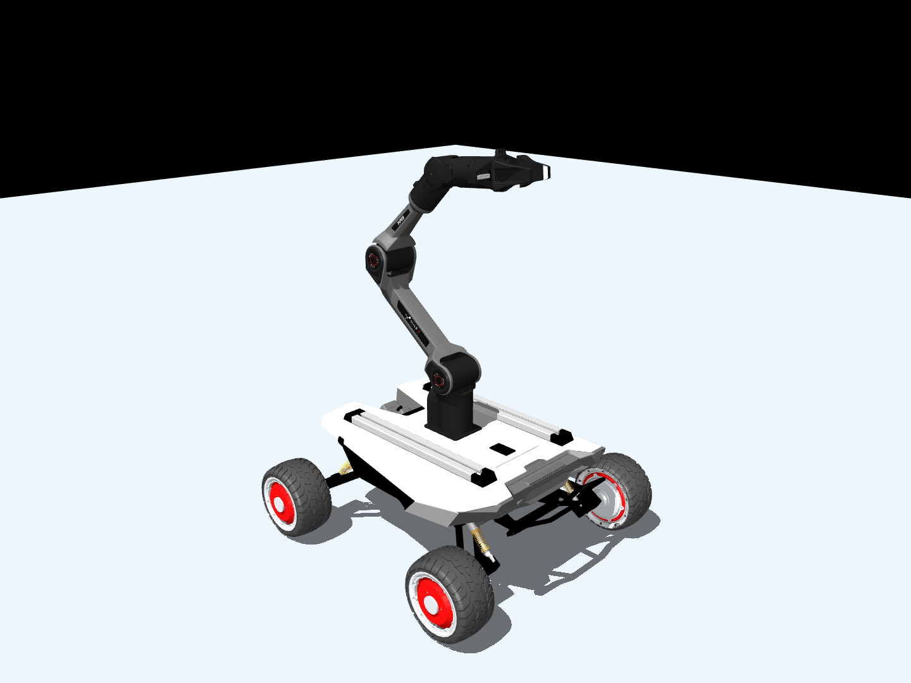

# Scout Mini + Piper in MuJoCo

Standalone mobile manipulator for the Robot Dynamics course: Scout Mini chassis,
four independent wheels, six Piper arm joints, and a parallel gripper. The arm
mounts directly on the chassis. No ROS, Gazebo, or Xacro is needed to run it.



## Install and view

Use Python 3.10 or newer (validated with Python 3.12 and MuJoCo 3.17.0):

```bash
python3 -m venv .venv
source .venv/bin/activate
python -m pip install -r requirements.txt
python scripts/viewer.py
```

The viewer starts **paused** in the `home` pose. Press **Space** to run/pause and
**R** to reset home. Use the mouse to rotate, pan, and zoom. The right panel's
**Joint** section exposes joint positions; while editing the gripper in a paused
scene, set `gripper_joint2 = -gripper_joint1`. Their symmetry constraint operates
when stepping. On macOS, launch the GUI with `mjpython scripts/viewer.py`.

```bash
python scripts/viewer.py --joints       # Show joint axes
python scripts/viewer.py --collisions   # Show simplified collision shapes
python scripts/viewer.py --run          # Start stepping immediately
python scripts/viewer.py --headless     # Run 5 seconds without a display
```

The arm moves under gravity when running: this task includes no actuators or
controllers to hold a pose. A desktop OpenGL environment is needed for the GUI.
Headless stepping needs no graphics setup.

## Validate

```bash
python scripts/validate_model.py
# Optional PNG, using EGL on headless Linux:
MUJOCO_GL=egl python scripts/validate_model.py --render docs/model_preview.png
```

Seven checks cover structure, assets, mounting clearance, inertias, source
kinematics, gripper opening, and a 10-second passive simulation. The source
kinematics check is skipped if the original source directory is absent.

## Files and model choices

- [`models/scout_piper/scene.xml`](models/scout_piper/scene.xml): complete MJCF scene with ground and floating robot.
- `models/scout_piper/assets/`: converted visual meshes and simplified collision hulls.
- [`scripts/viewer.py`](scripts/viewer.py): Python viewer and headless entry point.
- [`docs/model_notes.md`](docs/model_notes.md): mounting measurements, inertial audit, assumptions, and validation results.
- [`models/scout_piper/source_manifest.json`](models/scout_piper/source_manifest.json): source/asset checksums and original versus final physical parameters.

The mount is `xyz = (0, 0, 0.054) m`, `rpy = (0, 0, 0)` in Scout `base_link`.
All retained physical link masses come from the source. Three links retain their
original inertial tensors; mesh-inconsistent inertial tuples are replaced by
explicitly documented uniform-hull estimates. Contacts and mass distributions
are approximations intended for initial visualization and simulation.

To regenerate the delivered model from the **unchanged**, already extracted
`ppscout_ws-dev/` source (optional; not required at runtime):

```bash
python -m pip install -r requirements-assets.txt
python scripts/build_model.py
```

This checkout supplied the extracted directory rather than `ppscout_ws-dev.zip`.
The converter reads only the required descriptions/meshes. Third-party license
copies and provenance are included with the delivered model.
